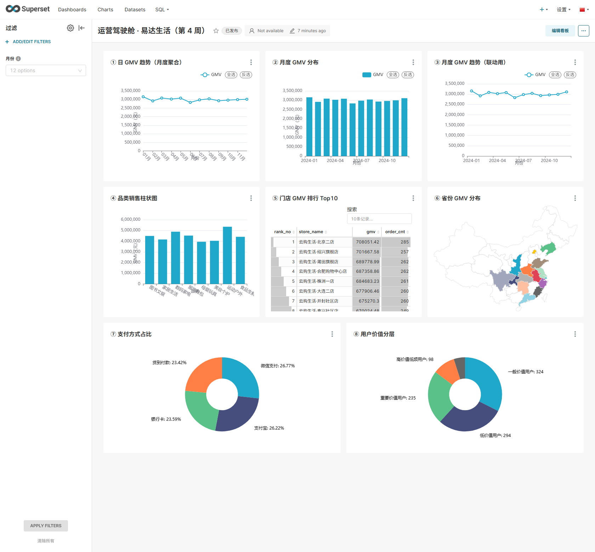
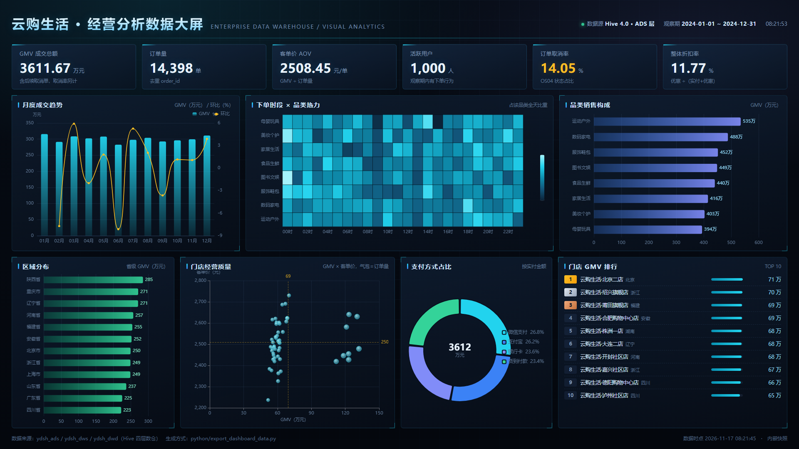
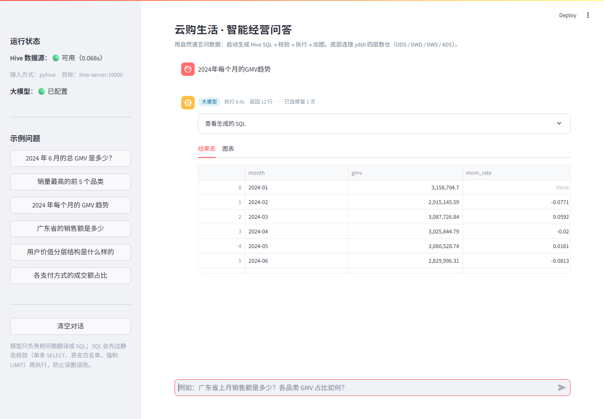

# Yundu Life · Enterprise Data Warehouse & Retail Analytics

**English** · [简体中文](README.zh-CN.md)

An end-to-end data platform for a Chinese omnichannel retailer: raw CSV → four-layer Hive
warehouse → metrics layer → forecasting & natural-language query → BI dashboard, data wall,
and one-command Docker deployment.

Every number in the product layer is traceable back to a raw row, and every layer is
reconciled against the one above it — **one GMV figure, 36,116,687.06 CNY, appears identically
in seven places** across Hive, MySQL, ClickHouse, the BI tool and the front end.

---

## Architecture

```
   6 CSV files
   114,809 rows
        │
        ▼
   ┌─────────┐   ┌─────────┐   ┌─────────┐   ┌─────────┐
   │   ODS   │──►│   DWD   │──►│   DWS   │──►│   ADS   │
   │  raw    │   │ detail  │   │ summary │   │ serving │
   └─────────┘   └─────────┘   └─────────┘   └────┬────┘
        │             │             │             │
        │             │             │      ┌──────┴───────┬──────────────┐
        │             │             │      ▼              ▼              ▼
        │             │             │   MySQL 8      ClickHouse     JSON snapshot
        │             │             │   (serving)    (analytics)    (data wall)
        │             │             │      │              │              │
        │             │             │      └──────┬───────┘              │
        │             │             │             ▼                      ▼
        │             │             │        Apache Superset        ECharts wall
        │             │             │        (8 charts, filters)    (7 panels)
        │             │             └──────────► Streamlit NL2SQL  ──► natural-language Q&A
        │             └────────────────────────► forecast model     ──► 7-day GMV forecast
        └──────────────────────────────────────► data quality reports

   └──────────────────── Docker Compose · 7 services ────────────────────┘
```

| Layer | Storage | What it holds |
|---|---|---|
| ODS | Hive (text) | 6 tables, 114,809 rows, **loaded as-is — no cleaning** |
| DWD | Hive (ORC/SNAPPY) | 20 tables: order fact partitioned by day (366 partitions) + 9 dimensions |
| DWS | Hive (ORC/SNAPPY) | 7 summary tables across day / week / month / category / store / channel / user |
| ADS | Hive (ORC/SNAPPY) | 10 application tables that feed BI, the wall and the Q&A bot |
| Serving | MySQL 8 | 6 wide tables for low-latency BI queries |
| Analytics | ClickHouse 24 | 4 MergeTree tables, 924 QPS under 8-way concurrency |

---

## Screenshots

| BI dashboard (Superset) | Data wall (ECharts) |
|---|---|
|  |  |

| Natural-language Q&A (Streamlit) |
|---|
|  |

---

## Key results

| Metric | Value |
|---|---|
| Annual GMV | **36,116,687.06 CNY** |
| Orders / buyers / stores | 14,398 / 1,000 / 60 |
| Data quality fix rate | **99.73%** (70,786 of 70,979 issues) |
| Forecast accuracy | **MAPE 11.79%** — beats the 7-day moving-average baseline (13.93%) |
| NL2SQL latency | **4.2 s** end-to-end, including one real LLM call |
| Query throughput (8 concurrent) | ClickHouse **924.83 QPS** · MySQL 728.08 · Hive 4.17 |
| End-to-end reconciliation | **67 assertions, 0 failures**, 30 s |

---

## Features

**Data engineering**
- Five-class dirty-data pipeline (missing / duplicate / outlier / malformed / non-standard enums)
  with before-and-after audit tables (`dq_report`, `dq_compare`).
- Dimension modelling (star schema) instead of normalisation — fewer joins, readable metrics.
- Day-level partitioning only on the fact table; dimensions stay unpartitioned on purpose.
- Category-level GMV is **allocated** from order payment by list-price weight, because the
  line-item price is a list price, not a transaction price (17× difference if summed naively).

**Analytics & AI**
- Time-series forecasting with lag / moving-average / calendar features; always benchmarked
  against three naive baselines.
- NL2SQL with four guardrails: prompt restriction, static validation (table allow-list,
  dangerous-keyword regex, forced `LIMIT`), one-shot repair on execution error, and a
  rule-based fallback when no LLM key is configured.

**Visualisation & delivery**
- Superset: 3 data sources, 10 datasets, 8 charts, 3-row dashboard with a month filter.
- ECharts wall: 7 panels, 5 chart types, fixed 1920×1080 stage with uniform scaling,
  dual data channel (live API, offline snapshot fallback).
- Streamlit Q&A: shows the generated SQL, the result table, the chart, and whether the
  query needed a self-repair round.

---

## Quick start

```bash
git clone <repo-url> && cd ydsh_week1
cp .env.example .env            # fill in 4 required secrets
docker compose up -d            # starts 7 services
```

Wait ~90 s, then:

| Entry point | URL |
|---|---|
| Natural-language Q&A | http://localhost:8501 |
| BI dashboard | http://localhost:8088 |
| Data API | http://localhost:8000/api/health |
| Data wall | open `dashboard/echarts/index.html` directly |

Load the warehouse (every step is idempotent):

```bash
bash scripts/import_ods.sh
for f in sql/clean/1[0-2]_*.sql sql/clean/2[0-3]_*.sql; do bash scripts/run_sql.sh "$f"; done
for f in sql/dwd/3[0-3]_*.sql sql/dws/5[01]_*.sql; do bash scripts/run_sql.sh "$f"; done
bash scripts/run_sql.sh sql/dwd/40_eda.sql
bash scripts/run_sql.sh sql/ads/60_build_ads_kpi.sql
bash scripts/run_sql.sh sql/ads/61_build_ads_app.sql
docker exec ydsh-app python /app/python/export_dashboard_data.py
docker exec ydsh-app python /app/python/load_mysql.py
docker exec ydsh-app python /app/python/load_clickhouse.py
docker exec ydsh-superset python /app/pythonpath/provision.py
```

Verify the whole chain:

```bash
docker cp python/verify_e2e.py ydsh-app:/app/verify_e2e.py
docker exec -w /app ydsh-app python verify_e2e.py
# → PASS 64 | FAIL 0 | WARN 3 — end-to-end chain is green
```

**Required `.env` keys** (missing any of them makes `docker compose up` fail fast, by design):

| Key | Notes |
|---|---|
| `MYSQL_ROOT_PASSWORD` | also used by the Hive Metastore |
| `CLICKHOUSE_PASSWORD` | ClickHouse `default` user |
| `SUPERSET_SECRET_KEY` | must be 42 random bytes, base64-encoded |
| `SUPERSET_ADMIN_PASSWORD` | ≥ 12 characters with symbols |

Optional: `DEEPSEEK_API_KEY` / `DASHSCOPE_API_KEY` / `ZHIPU_API_KEY` / `SILICONFLOW_API_KEY` /
`MOONSHOT_API_KEY` — any one enables the LLM path; without one, Q&A falls back to rules.

---

## Tech stack

| Concern | Choice | Why |
|---|---|---|
| Warehouse | Apache Hive 4.0 + Tez | required layered model; Metastore integrates with Superset |
| File format | ORC + SNAPPY | predicate pushdown and compression |
| Serving DB | MySQL 8 | reuses the Metastore instance |
| OLAP | ClickHouse 24 | fast single-node aggregation, ~200× Hive throughput |
| BI | Apache Superset 4.1 | open source, multi-source, China map built in |
| Wall | ECharts 5.5.1 | free, offline-capable, wide chart coverage |
| Q&A UI | Streamlit 1.40 | cheapest to build, testable headlessly via `AppTest` |
| Hive access | pyhive | ~0.3–0.8 s vs several seconds for a beeline JVM client |
| Orchestration | Docker Compose | single-host demo; Kubernetes would be overkill |
| LLM | OpenAI-compatible API | one client for five providers |

---

## Project structure

```
ydsh_week1/
├── docker-compose.yml        7 services with health-check chaining
├── sql/                      ods / clean / dwd / dws / ads
├── scripts/                  import_ods.sh, run_sql.sh
├── python/                   cleaning, modelling, export, benchmark, verify_e2e
├── app/                      Streamlit app, data API, Hive access layer
├── dashboard/echarts/        data wall with a local echarts.min.js
├── superset/                 custom image, bootstrap, ORM-based provisioning
├── clickhouse/init/          analytics-layer DDL
├── data/                     raw CSV, serving exports, forecast and E2E results
├── docs/                     all documentation and screenshots
└── tools/                    md2docx, CDP screenshot helper
```

## Documentation

| Document | Content |
|---|---|
| [需求文档](docs/项目文档/01_需求文档.md) | business context, requirements, metric definitions |
| [数据质量清洗报告](docs/项目文档/02_数据质量清洗报告.md) | five dirty-data classes, fix rates, re-audit |
| [架构设计文档](docs/项目文档/03_架构设计文档.md) | four-layer model, modelling, tech choices, trade-offs |
| [部署手册](docs/项目文档/04_部署手册.md) | prerequisites, init order, 12 troubleshooting entries |
| [API 配置指南](docs/项目文档/05_API配置指南.md) | LLM providers, data API, data sources, error codes |
| [端到端联调报告](docs/第5周_端到端联调报告.md) | 67 assertions, 3 real defects found and fixed |

## Data caveats

This is a synthetic teaching dataset. Three properties are deliberately documented rather
than hidden, because they change how the numbers should be read:

1. **Repurchase rate is 100%** — every one of the 1,000 users ordered 14.4 times on average.
   This is a dataset artefact, not evidence of customer stickiness.
2. **Line-item `unit_price` is a list price**, not a transaction price. Summing
   `quantity × unit_price` yields 617 M CNY, 17× the actual 36 M CNY paid. Any
   category-share analysis must allocate order payment, not sum line items.
3. **0.97% of orders cannot be attributed to a category** — 139 orders lost all line items
   during cleaning (their only line had a negative unit price). They are reported as an
   explicit "unknown category" bucket (349,609.44 CNY) instead of being silently dropped.

## Known limitations

- Superset 4.1 cross-filtering does not fire on click even with `emitCrossFilters`, scopes and
  the `DASHBOARD_CROSS_FILTERS` flag all set; the month native filter is used instead.
- The forecast model is an offline artefact: `scikit-learn` is not in the runtime image.
- Single-node deployment, no HA. Appropriate for a course demo, not for production.

## Team

| Name | Role |
|---|---|
| Qu Xinfeng | project lead / data engineer / analyst / visualisation & deployment |

Course project · Enterprise Project Practice · Data Science and Big Data Technology (BSc).
