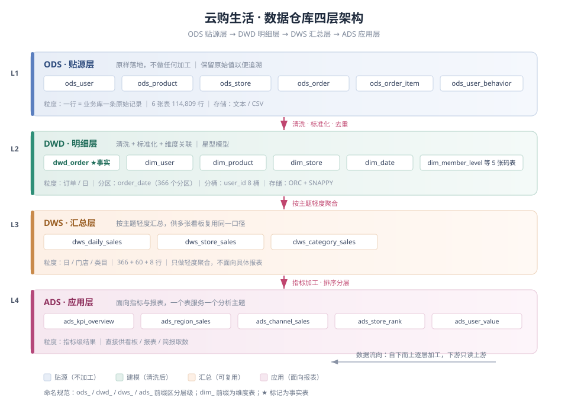

# 数仓架构设计文档

> 项目：云购生活新零售企业 —— 企业级数据仓库与经营分析可视化系统
> 阶段：第 2 周 · 子任务 5
> 团队：云购生活数据仓库项目组 ｜ 成员：曲欣锋
> 版本：v1.0（2026-11-02）

---

## 一、架构总览

本项目采用 **ODS → DWD → DWS → ADS 四层架构**，数据自下而上单向流动，下游只读上游、不反向写回。四层之间以「表名前缀」区分，任何人看到表名即可判断它属于哪一层、能不能改。



各层定位一句话概括：

| 层级 | 定位 | 一句话说明 | 表名前缀 | 数据粒度 |
|---|---|---|---|---|
| **ODS** | 贴源层 | 业务数据原样落地，一个字段都不改 | `ods_` | 一行 = 业务库一条原始记录 |
| **DWD** | 明细层 | 洗干净、统一口径、按星型模型重组 | `dwd_` / `dim_` | 订单粒度（事实）/ 实体粒度（维度） |
| **DWS** | 汇总层 | 按分析主题轻度汇总，多张报表复用同一口径 | `dws_` | 日 / 门店 / 类目 |
| **ADS** | 应用层 | 面向具体指标与报表，一表一主题 | `ads_` | 指标级结果 |

---

## 二、各层设计说明

### 2.1 ODS 贴源层（ydsh_ods）

**职责**：只做「搬运」，不做任何加工。

| 表名 | 行数 | 说明 |
|---|---|---|
| `ods_user` | 1,000 | 用户（含脏值：gender 8 种取值、age 有 200/-3） |
| `ods_product` | 600 | 商品（类目带尾随空格、价格有负值） |
| `ods_store` | 60 | 门店（第一周评估五维度全 0，唯一干净表） |
| `ods_order` | 15,600 | 订单（order_id 有 600 条重复、金额有负值与百万级离群值） |
| `ods_order_item` | 37,549 | 订单明细（quantity 有 0 与负数） |
| `ods_user_behavior` | 60,000 | 用户行为（行为类型中英文混用、时间格式两种） |

**关键设计决策：所有字段一律 STRING。**

理由：贴源层的第一原则是「原样落地」。脏数据的典型表现就是类型不合法（`age=200`、`price=-626.74`、`order_date=2024/07/26`），如果建表时就声明成 INT / DATE，异常值会导致装载直接失败，或者被静默转成 NULL —— 问题不是被解决，而是被藏起来了。先在 STRING 层完整保留原始痕迹，把类型转换推到 DWD 层并配合校验，才能做到「问题可发现、可追溯」。

**技术细节**：`ROW FORMAT DELIMITED FIELDS TERMINATED BY '\001'`，`TBLPROPERTIES("skip.header.line.count"="1")` 跳过 CSV 表头。装载前对 CSV 做了去 BOM + CRLF→LF 预处理，否则 `\r` 会被读进每行最后一个字段。

### 2.2 DWD 明细层（ydsh_dwd）

**职责**：清洗 + 标准化 + 维度建模。这是全项目工作量最大的一层，也是口径的唯一来源。

清洗分三步落地（脚本 `sql/clean/20` → `21` → `22`），产出一组 `dwd_*_clean` 中间表：

| 脚本 | 处理内容 | 产出 |
|---|---|---|
| `20_enum_standardize.sql` | 枚举字段标准化、基础清洗（年龄中位数、订单去重） | 6 张 `dwd_*_clean` |
| `21_abnormal_format.sql` | 异常值处理（金额/数量/价格/年龄）、日期与手机号格式统一 | 原地更新 |
| `22_split_merge_map.sql` | 字段合并（时间戳、大区）、编码映射表与编码回填 | 原地更新 + 5 张码表 |

**星型模型设计**：以订单事实表 `dwd_order` 为中心，关联 4 张维度表。

```
                    dim_date
                       |
        dim_user ── dwd_order ── dim_store
                       |
                  dim_product
                （经 dwd_order_item 关联）
```

| 表名 | 类型 | 主键 | 行数 |
|---|---|---|---|
| `dwd_order` | 事实表 | order_id | 14,398 |
| `dwd_order_item` | 事实（明细）表 | item_id | 34,580 |
| `dwd_user_behavior` | 事实（行为）表 | behavior_id | 60,000 |
| `dim_user` | 维度表 | user_id | 1,000 |
| `dim_product` | 维度表 | product_id | 600 |
| `dim_store` | 维度表 | store_id | 60 |
| `dim_date` | 维度表 | date_key | 366 |

**码表（小型维度）**：`dim_member_level`、`dim_pay_type`、`dim_order_status`、`dim_channel`、`dim_behavior_type`。

建模时 DWD 只存**编码**（如 `PT01`），中文名在展示层 JOIN 码表取。这样中文口径变更（例如「已完成」改叫「交易完成」）只需改码表一行，不用扫全表更新。

**度量与属性的划分原则**：能求和的进事实表（`pay_amount`、`discount_amount`、`order_cnt`），纯描述性的进维度表。判断方法：问一句「这个字段需要 SUM / AVG 吗」，需要就是度量。

### 2.3 DWS 汇总层（ydsh_dws）

**职责**：把 DWD 的明细按主题做轻度聚合，只到「日 / 门店 / 类目」这一层，不往上拼具体报表。

| 表名 | 粒度 | 行数 |
|---|---|---|
| `dws_daily_sales` | 日 | 366 |
| `dws_store_sales` | 门店 | 60 |
| `dws_category_sales` | 类目 | 8 |

**为什么要有这一层**：多个看板（日报、月报、区域分析）都会用到「日 GMV」这个数，如果每个看板各自从 DWD 算一遍，算法稍有出入就会出现「同一个 GMV，两个页面两个数」。汇总层的作用就是把口径固化一次，下游复用。

**口径一致性已验证**：事实表 GMV、日汇总 GMV、门店汇总 GMV 三者完全相等（36,116,687.06），类目汇总因部分订单无明细略有差异（见第五章遗留问题）。

### 2.4 ADS 应用层（ydsh_ads）

**职责**：面向分析主题的成品指标表，一个表服务一个看板。

| 表名 | 主题 | 内容 |
|---|---|---|
| `ads_kpi_overview` | 总览 | GMV / 订单量 / 用户数 / AOV / ARPU 等 8 项核心指标 |
| `ads_region_sales` | 区域 | 各省订单量、用户数、GMV 及占比 |
| `ads_channel_sales` | 渠道 | 各渠道订单量、GMV、客单价及占比 |
| `ads_store_rank` | 门店 | 门店 GMV 排名 Top15 |
| `ads_user_value` | 用户 | RFM 分层结果与分层 GMV 贡献 |

---

## 三、命名规范

| 规则 | 说明 | 示例 |
|---|---|---|
| 表名前缀标识层级 | `ods_` / `dwd_` / `dws_` / `ads_` | `ods_order`、`dws_daily_sales` |
| 维度表统一 `dim_` | 与事实表区分 | `dim_user`、`dim_date` |
| 清洗中间表加 `_clean` | 表示「已清洗、待建模」 | `dwd_order_clean` |
| 码表加 `dim_` + 实体 | 小型维度 | `dim_pay_type` |
| 主键 = `<实体>_id` | 事实表用同名外键关联 | `user_id`、`store_id` |
| 日期字段统一 `_date` | 字符串 `yyyy-MM-dd` | `order_date`、`launch_date` |
| 时间戳统一 `_timestamp` | 字符串 `yyyy-MM-dd HH:mm:ss` | `order_timestamp` |
| 编码字段统一 `_code` | 存编码不存中文 | `pay_type_code` |
| 中文名统一 `_name` | 冗余一份便于直查 | `pay_type_name` |
| 标记位统一 `_flag` | 记录清洗动作 | `email_flag`、`phone_flag` |
| 数据库名 `ydsh_<层>` | 一层一库 | `ydsh_ods` / `ydsh_dwd` / `ydsh_dws` / `ydsh_ads` |

---

## 四、存储与性能设计

### 4.1 存储格式：ORC + SNAPPY

所有 DWD / DWS / ADS 表统一 `STORED AS ORC`，并显式指定 `orc.compress=SNAPPY`。

选择理由：
- ORC 是列式存储，分析型查询通常只读少数几列，列裁剪收益明显；
- 自带轻量索引（min/max、布隆过滤器），谓词下推能跳过整个 stripe；
- SNAPPY 解压速度快于 GZIP，在 CPU 与 IO 之间取得平衡（数据量不大时压缩率差异可忽略）。

### 4.2 分区策略：事实表按 order_date 按天分区

`dwd_order` 已建 366 个分区（2024-01-01 ~ 2024-12-31，2024 为闰年）。

为什么按天而不是按月：
1. 业务查询几乎都带时间范围（日报、周报、同环比），按天分区能让裁剪粒度最细；
2. 按天分区与 DWS 的日汇总粒度对齐，重跑某一天只需覆盖单个分区，不会波及其他日期；
3. 本项目单日数据量仅 40 行左右，按月分区反而让单分区过大、失去裁剪收益。

### 4.3 分桶：user_id 哈希分 8 桶

`dwd_order_bucket` 以 `CLUSTERED BY (user_id) INTO 8 BUCKETS` 建表，实测写入后生成 8 个桶文件，行数与非分桶表一致（14,398）。

分桶的价值在 JOIN：当两张表都按 `user_id` 分桶且桶数成倍数关系时，Hive 可以把连接下推到 Map 端（Bucket Map Join），省掉一轮全量 Shuffle。本项目的用户维度关联、用户级窗口计算都用得上。

**为什么主事实表不直接分桶**：分区表 + 分桶表叠加时，分桶文件会随分区数量倍增（366 × 8 = 2,928 个文件），对小数据量来说是负优化。因此主表保持「分区 + ORC」的最简组合，分桶能力单独用一张表演示。

---

## 五、设计取舍与已知问题

| 决策 | 备选方案 | 选择理由 |
|---|---|---|
| 贴源层全 STRING | 建表即声明类型 | 避免异常值导致装载失败或被静默置 NULL |
| 码表存编码而非直接存中文 | 直接写中文名 | 口径变更只改码表一行，不用全表更新 |
| 事实表按天分区 | 按月分区 | 查询按天切片，需要最细裁剪粒度 |
| 类目 GMV 按订单金额分摊 | 用明细单价×数量直接汇总 | 明细单价是吊牌价口径，直接汇总会比订单 GMV 高一个量级，无法对账 |
| `dwd_*_clean` 独立于 `dim_*` | 清洗结果直接命名成 dim_ | 清洗与建模职责分离，清洗脚本可单独重跑验收 |

**已知问题（遗留）**：

1. **139 笔订单无明细**：14,398 笔订单中 14,259 笔有明细（99.03%），剩余 139 笔（对应 GMV 349,609.43 元）在明细表中查不到对应记录。因此类目汇总 GMV 合计为 35,767,077.63 元，比订单侧 GMV 少约 34.96 万元。这属于源数据完整性问题，不在本周清洗范围内，已记录待与数据提供方确认。
2. **第一周遗留表未清理**：`ydsh_dwd` 中仍有第一周的 `dwd_user` / `dwd_product` / `dwd_order`（非分区版）。它们作为第一周验收证据保留，第 2 周起以 `dim_*` 与分区版 `dwd_order` 为准。为避免混淆，README 已注明两者关系。
3. **中文枚举与第一周口径不一致**：第一周会员等级用短名（金卡/银卡/钻石/普通），第 2 周按任务书要求统一为全称（金卡会员等），两者一一对应，已在质量报告中说明沿革。

---

## 六、数据流向与执行顺序

```
原始 CSV
   │  02_load_data.sql
   ▼
ODS（6 表，114,809 行）
   │  20_enum_standardize.sql   ← 枚举标准化 + 基础清洗
   ▼
dwd_*_clean（清洗中间态）
   │  21_abnormal_format.sql    ← 异常值 + 格式统一
   │  22_split_merge_map.sql    ← 字段合并 + 编码映射
   ▼
dwd_*_clean（清洗完成态）
   │  30_create_dim_tables.sql  ← 建维度表结构
   │  31_create_fact_order.sql  ← 建事实表结构（分区 + 分桶）
   │  32_load_dwd.sql           ← 先维度、后事实加载
   ▼
DWD（4 维 + 3 事实）
   │  33_load_dws.sql
   ▼
DWS（3 表）
   │  40_eda.sql
   ▼
ADS（5 表）+ 分析简报
```

**一键复现命令**：

```bash
cd /d/新建文件夹/ydsh_week1
for f in sql/clean/20_enum_standardize.sql sql/clean/21_abnormal_format.sql \
         sql/clean/22_split_merge_map.sql sql/clean/23_quality_compare.sql \
         sql/dwd/30_create_dim_tables.sql sql/dwd/31_create_fact_order.sql \
         sql/dwd/32_load_dwd.sql sql/dwd/33_load_dws.sql sql/dwd/40_eda.sql; do
  bash scripts/run_sql.sh "$f"
done
```

---

## 七、本周架构工作的验收对照

| 任务书要求 | 完成情况 | 证据 |
|---|---|---|
| 设计四层架构 | ODS/DWD/DWS/ADS 四层全部落地 | 本文档 + `show databases` |
| 明确每层定位、粒度、命名规范 | 见第二章、第三章 | 本文档 |
| 绘制架构图并标注数据流向 | SVG 架构图 | `docs/images/数仓架构图.svg` |
| 星型模型组织 DWD | 订单事实表 + 4 维表 | 第四章 |
| 分区表优化 | 366 个日分区 | `SHOW PARTITIONS dwd_order` |
| 尝试分桶表 | 8 桶，桶文件数实测为 8 | `dwd_order_bucket` |
